<!-- generated by scripts/render.py, edits here get overwritten -->

  

  <a href="https://t.me/HeartedWhyMe"><code>telegram</code></a>&nbsp;
  <a href="https://me-l.co/sy5vuawa"><code>me-l.co</code></a>&nbsp;
  <a href="https://www.linkedin.com/in/bogdan-lazarev-a77998443"><code>linkedin</code></a>
  &nbsp;·&nbsp;
  <a href="https://github.com/TheAweny/case-14-ai-presentation-designer-team-41"><code>case-14</code></a>&nbsp;
  <a href="https://github.com/awesome-dsh-plugin/awesome-dsh-plugin"><code>awesome-dsh</code></a>&nbsp;
  <a href="https://github.com/adsqwui/bitrix24-mcp"><code>bitrix24-mcp</code></a>&nbsp;
  <a href="https://github.com/adsqwui/telegram-mcp"><code>telegram-mcp</code></a>

